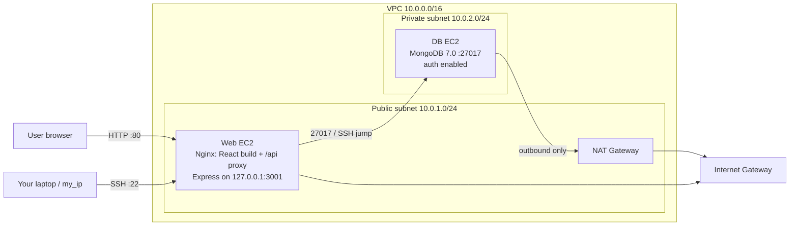

# TravelMemory (MERN) on AWS with Terraform + Ansible

Infrastructure is provisioned with **Terraform** and the servers are configured, secured and deployed with **Ansible**.

App: <https://github.com/UnpredictablePrashant/TravelMemory>



## Repository layout

```
terraform/
  providers.tf            AWS provider, default tags
  variables.tf            region, CIDRs, my_ip, key paths, instance types
  vpc.tf                  VPC, public+private subnets, IGW, NAT GW, route tables
  security_groups.tf      web SG (80 from all, 22 from my_ip) / db SG (22+27017 from web SG only)
  iam.tf                  EC2 role + instance profile (SSM + CloudWatch agent)
  ec2.tf                  Ubuntu 22.04 web + db instances, key pair, generates ansible/inventory.ini
  outputs.tf              web public IP, private IPs, SSH commands, app URL
  templates/inventory.tftpl
ansible/
  ansible.cfg  site.yml  requirements.yml
  group_vars/all/main.yml         app + Mongo settings
  group_vars/all/vault.yml.example  passwords (copy -> vault.yml, encrypt)
  group_vars/web.yml, db.yml      per-tier firewall rules
  roles/common    apt updates, SSH hardening, root lock, fail2ban, UFW, auto security updates
  roles/mongodb   MongoDB 7.0, bind to private IP, auth, admin + app users
  roles/webserver Node.js 20, Nginx, clone repo, .env files, systemd backend, React build
REPORT.md         implementation report (submission deliverable)
screenshots/      put your proof screenshots here
```

---

## Step-by-step

### 0. Prerequisites (on your laptop / WSL / Linux / macOS)

| Tool | Check |
|---|---|
| AWS account + IAM user with programmatic access | – |
| AWS CLI v2 | `aws --version` |
| Terraform ≥ 1.5 | `terraform -version` |
| Ansible ≥ 2.15 (Linux/macOS/WSL — not native Windows) | `ansible --version` |
| Git | `git --version` |

> On Windows, run everything from **WSL (Ubuntu)**. Ansible's control node does not run on native Windows.

### 1. Configure AWS CLI

```bash
aws configure            # Access key, Secret key, region: ap-south-1, output: json
aws sts get-caller-identity   # must print your account ID
```

### 2. Create an SSH key pair

```bash
ssh-keygen -t ed25519 -f ~/.ssh/travelmemory -N ""
chmod 600 ~/.ssh/travelmemory
```

### 3. Provision infrastructure with Terraform

```bash
cd terraform
cp terraform.tfvars.example terraform.tfvars
curl -s https://checkip.amazonaws.com        # put this IP + /32 into my_ip
nano terraform.tfvars

terraform init
terraform fmt
terraform validate
terraform plan
terraform apply          # type yes
```

Outputs show `web_public_ip`, `db_private_ip`, `app_url`, and SSH commands.
Terraform also writes `ansible/inventory.ini` for you (DB is reached via the web server as a jump host).

Quick check:
```bash
ssh -i ~/.ssh/travelmemory ubuntu@<web_public_ip>
ssh -i ~/.ssh/travelmemory -J ubuntu@<web_public_ip> ubuntu@<db_private_ip>
```

### 4. Configure and deploy with Ansible

```bash
cd ../ansible
ansible-galaxy collection install -r requirements.yml

cp group_vars/all/vault.yml.example group_vars/all/vault.yml
nano group_vars/all/vault.yml                # set two strong passwords
ansible-vault encrypt group_vars/all/vault.yml

ansible all -m ping --ask-vault-pass         # both web1 and db1 => pong
ansible-playbook site.yml --ask-vault-pass
```

The playbook runs three plays in order:
1. **common** (both hosts) – updates, SSH hardening, fail2ban, UFW.
2. **mongodb** (db) – installs MongoDB 7.0, enables auth, creates `mongoadmin` and `travelapp` users.
3. **webserver** (web) – Node.js 20 + npm, clones the repo, writes `.env` files, runs backend as a systemd service, builds React, serves it with Nginx, and smoke-tests `/health`.

It ends with: `TravelMemory is live at http://<web_public_ip>`.

### 5. Verify and take screenshots

Open `http://<web_public_ip>` and add a trip. Capture these for `screenshots/`:

1. `terraform apply` output (with web public IP)
2. AWS console: VPC resource map, subnets, route tables, NAT GW, security groups, both EC2 instances, IAM role
3. `ansible all -m ping` and the final `PLAY RECAP` (failed=0)
4. Browser: home page, add-trip form, trip list showing the new trip
5. `curl http://<web_public_ip>/api/health` → `{"status":"ok","db":"connected"}`
6. Security proof:
   - `ssh root@<web_public_ip>` → *Permission denied*
   - on db: `mongosh --eval "db.getSiblingDB('admin').runCommand({listDatabases:1})"` → *requires authentication*
   - `sudo ufw status verbose` on both servers
   - `curl --max-time 5 http://<web_public_ip>:3001` from laptop → times out (backend not exposed)

### 6. Push to GitHub and submit

```bash
cd ..                       # repo root
git init && git add . && git commit -m "TravelMemory MERN on AWS with Terraform + Ansible"
git branch -M main
git remote add origin https://github.com/<you>/travelmemory-terraform-ansible.git
git push -u origin main
```
`.gitignore` keeps state files, `terraform.tfvars`, `inventory.ini`, the vault file and keys out of Git — check `git status` before pushing.
Put the repo link in a .txt / Word / PDF file and upload it on Vlearn.

### 7. Tear down (important – NAT Gateway is billed hourly)

```bash
cd terraform && terraform destroy
```

---

## Troubleshooting

| Symptom | Fix |
|---|---|
| `ansible ping` to db1 times out | Web server must be reachable first; your IP may have changed → update `my_ip`, `terraform apply` |
| SSH `Permission denied (publickey)` | Check `private_key_path` in tfvars matches the key used in step 2 |
| React build killed / exit 137 | Out of memory. Playbook adds 2 GB swap; or set `web_instance_type = "t3.small"` (default) or larger |
| Page loads but trips don't save | `curl http://<ip>/api/health`; check `sudo journalctl -u travelmemory-backend -n 50` and that `CORS_ORIGIN` matches the URL you browse |
| Public IP changed after stop/start | `terraform apply` (refreshes inventory) then rerun `ansible-playbook site.yml` to rebuild the frontend |
