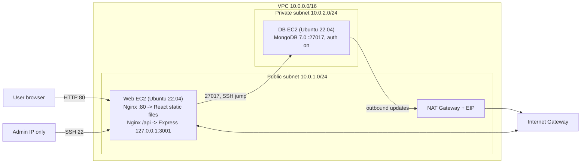

# Implementation Report – Deploying the TravelMemory MERN Application with Terraform and Ansible

**Author:** Syed Mohammad Sadik
**Cloud:** AWS (region `ap-south-1`, Mumbai)
**Application:** TravelMemory – React frontend, Express/Node.js backend, MongoDB database

---

## 1. Objective

Deploy a MERN application on AWS so that the whole environment can be rebuilt from code:
Terraform creates the network, servers, security groups and IAM, and Ansible installs, configures, secures and deploys the software. Nothing is configured by hand on the servers.

## 2. Architecture

| Component | Where | Purpose |
|---|---|---|
| VPC `10.0.0.0/16` | – | Isolated network |
| Public subnet `10.0.1.0/24` | AZ a | Web server, NAT Gateway |
| Private subnet `10.0.2.0/24` | AZ a | MongoDB server, no public IP |
| Internet Gateway | VPC | Internet access for public subnet |
| NAT Gateway | public subnet | Outbound-only internet for the DB (apt, MongoDB repo) |
| Public route table | public subnet | `0.0.0.0/0 → IGW` |
| Private route table | private subnet | `0.0.0.0/0 → NAT GW` |
| Web EC2 | public subnet | Nginx + React build + Express (systemd) |
| DB EC2 | private subnet | MongoDB |
| IAM role + instance profile | both EC2 | SSM Session Manager + CloudWatch agent permissions |

## 3. Part 1 – Infrastructure with Terraform

### 3.1 AWS setup and initialization
- AWS CLI configured with `aws configure`; identity verified with `aws sts get-caller-identity`.
- Terraform project uses the `hashicorp/aws ~> 5.0` provider; `default_tags` tag every resource with `Project` and `ManagedBy=Terraform`.
- Commands: `terraform init → validate → plan → apply`.

### 3.2 VPC and networking (`vpc.tf`)
- One VPC with DNS support/hostnames enabled.
- Public subnet auto-assigns public IPs; private subnet does not.
- Internet Gateway attached to the VPC.
- NAT Gateway with an Elastic IP is placed in the **public** subnet so private instances can reach the internet outbound only.
- Two route tables associated to their subnets (public → IGW, private → NAT).

### 3.3 EC2 provisioning (`ec2.tf`)
- Latest Canonical Ubuntu 22.04 AMI selected through a data source (no hard-coded AMI ID).
- **Web** instance (`t3.small`) in the public subnet; **DB** instance (`t3.micro`) in the private subnet with `associate_public_ip_address = false`.
- An SSH key pair is created from the user's local public key; the private key never leaves the laptop.
- Hardening at the infra level: IMDSv2 required, encrypted gp3 root volumes.
- Terraform renders `ansible/inventory.ini` from a template so Ansible always has current IPs.

### 3.4 SSH access
- Web: SSH allowed **only from my public IP** (`my_ip` variable, `/32`).
- DB: no public IP, so SSH goes through the web server as a jump host (`ssh -J`, Ansible `ProxyCommand`). Its security group only accepts SSH from the web security group.

### 3.5 Security groups (`security_groups.tf`)

| SG | Inbound | Source |
|---|---|---|
| web-sg | 22/tcp | my_ip/32 |
| web-sg | 80/tcp | 0.0.0.0/0 |
| db-sg | 22/tcp | web-sg |
| db-sg | 27017/tcp | web-sg |

Port 3001 (Express) is **not** opened anywhere; it is only reached by Nginx on localhost.
Using SG references instead of IPs means rules stay correct even if private IPs change.

### 3.6 IAM (`iam.tf`)
An EC2 role with `AmazonSSMManagedInstanceCore` (Session Manager access as a break-glass path that needs no open port) and `CloudWatchAgentServerPolicy` (logs/metrics). Attached to both instances through an instance profile. No access keys are stored on the servers.

### 3.7 Outputs (`outputs.tf`)
`web_public_ip` (required), plus `db_private_ip`, `app_url`, and ready-to-use SSH commands.

## 4. Part 2 – Configuration and deployment with Ansible

### 4.1 Ansible configuration
- `ansible.cfg` points to the generated inventory, enables SSH pipelining and connection reuse.
- Inventory groups: `web` (public IP) and `db` (private IP via jump host).
- Secrets (MongoDB passwords) live in `group_vars/all/vault.yml`, encrypted with **Ansible Vault**.
- `site.yml` waits for SSH and for cloud-init to finish, then applies three roles.

### 4.2 Role `common` (both servers)
- `apt` update + safe upgrade; installs ufw, fail2ban, unattended-upgrades, git, rsync, acl.
- SSH hardening drop-in (`/etc/ssh/sshd_config.d/00-hardening.conf`): `PermitRootLogin no`, `PasswordAuthentication no`, key-only auth, `MaxAuthTries 3`, `AllowUsers ubuntu`; config validated with `sshd -t` before restart.
- Root password locked.
- fail2ban jail for SSH (5 attempts → 1 h ban).
- Automatic security updates enabled.
- UFW: default deny incoming; SSH allowed first (avoids lock-out); then tier rules — web: 80; db: 22 and 27017 **only from the web server's private IP**.

### 4.3 Role `mongodb` (database server)
1. Adds the official MongoDB 7.0 apt repository and signing key, installs `mongodb-org`.
2. `mongod.conf`: `bindIp: 127.0.0.1,<private IP>` (never `0.0.0.0`) and `security.authorization: enabled`.
3. Creates the **admin** user (`root` role) using MongoDB's localhost exception on first run; on later runs it detects the admin already works and skips.
4. Creates the **application** user `travelapp` with `readWrite` only on the `travelmemory` database (least privilege). Re-runs update the password instead of failing.
5. Passwords are passed via environment variables (not on the command line) and tasks use `no_log`.
6. Verifies that unauthenticated access is rejected.

### 4.4 Role `webserver` (web server)
1. Adds a 2 GB swap file (the React production build needs more than 1 GB RAM).
2. Installs **Node.js 20 and npm** from NodeSource, and Nginx.
3. Creates a non-login system user `travelapp`, clones the repository to `/opt/travelmemory`.
4. Backend: writes `backend/.env` (mode 600) with `MONGO_URI`, `PORT=3001`, `CORS_ORIGIN`, `TRUST_PROXY=1`; runs `npm install`; installs a hardened **systemd** unit (`Restart=always`, `NoNewPrivileges`, `ProtectSystem=strict`).
5. Frontend: writes `frontend/.env` with `REACT_APP_BACKEND_URL=http://<web_public_ip>/api`, runs `npm install` and `npm run build` (only when code/config changed), and syncs the build to `/var/www/travelmemory`.
6. Nginx site: serves the React files, falls back to `index.html` for client-side routes, and proxies `/api/*` to Express; adds security headers and hides the Nginx version.
7. Smoke tests: `/health` must report `db: connected`, `/api/trip` and `/` must return 200.

### 4.5 Environment variables

| File | Variable | Value |
|---|---|---|
| backend/.env | MONGO_URI | `mongodb://travelapp:<pwd>@<db_private_ip>:27017/travelmemory?authSource=travelmemory` |
| backend/.env | PORT | 3001 |
| backend/.env | CORS_ORIGIN | `http://<web_public_ip>` |
| backend/.env | TRUST_PROXY | 1 (behind Nginx) |
| frontend/.env | REACT_APP_BACKEND_URL | `http://<web_public_ip>/api` |

## 5. How the components interact

1. The user opens `http://<web_public_ip>`. The request passes the web SG (port 80) and UFW and reaches **Nginx**.
2. Nginx returns the static **React** build (HTML/JS/CSS).
3. React (running in the browser) calls the API at `http://<web_public_ip>/api/trip` using axios.
4. Nginx strips `/api` and proxies to **Express** on `127.0.0.1:3001`. Because the frontend and API share one origin, only port 80 is public; Express also enforces CORS for that origin.
5. Express (Mongoose) connects to **MongoDB** at `<db_private_ip>:27017` over the private subnet, authenticating as `travelapp`. The DB SG and UFW only allow this from the web server.
6. MongoDB stores/returns trip documents; Express sends JSON back through Nginx to the browser. Uploaded images are saved under `backend/uploads` and served at `/api/uploads/...`.
7. The DB server never accepts inbound internet traffic; it only goes **out** through the NAT Gateway for package updates.
8. Administrators SSH only from the allowed IP to the web server, and to the DB through the web server.

## 6. Security measures summary

| Layer | Control |
|---|---|
| Network | Private subnet for DB, no public IP; NAT for outbound only |
| Security groups | SSH from my IP only; DB ports only from web SG; Express port not exposed |
| Host firewall | UFW default-deny on both servers |
| SSH | Key pairs only, root login disabled, password auth off, AllowUsers, MaxAuthTries 3, fail2ban |
| OS | Root account locked, unattended security upgrades |
| Instances | IMDSv2 enforced, encrypted EBS volumes, IAM role instead of access keys |
| Database | Auth enabled, bound to private IP, least-privilege app user, passwords in Ansible Vault |
| Application | Runs as non-login user under a sandboxed systemd unit, `.env` mode 600, Nginx security headers, version hidden |
| Repository | State, tfvars, inventory, vault and keys excluded via `.gitignore` |

## 7. Verification evidence

See `screenshots/`:
- `01-terraform-apply.png` – apply complete + outputs
- `02-aws-vpc-resource-map.png`, `03-security-groups.png`, `04-ec2-instances.png`
- `05-ansible-ping.png`, `06-ansible-recap.png`
- `07-app-home.png`, `08-add-trip.png`, `09-trip-list.png`
- `10-health-endpoint.png`, `11-security-checks.png`

## 8. Challenges and resolutions

| Challenge | Resolution |
|---|---|
| DB has no public IP, so Ansible can't reach it directly | Inventory uses SSH `ProxyCommand` through the web server |
| apt lock errors right after boot | Play waits for `cloud-init status --wait` |
| React build ran out of memory on small instances | 2 GB swap + `NODE_OPTIONS=--max-old-space-size=1536` |
| Creating Mongo users with auth already on | Used the localhost exception for the first admin, then authenticated for everything else; idempotent on reruns |
| Browser CORS errors | Same-origin `/api` proxy in Nginx and `CORS_ORIGIN` set to the public URL |

## 9. Cost and clean-up
The NAT Gateway and its Elastic IP are billed hourly. After demonstrating and capturing evidence, everything is removed with `terraform destroy`.
